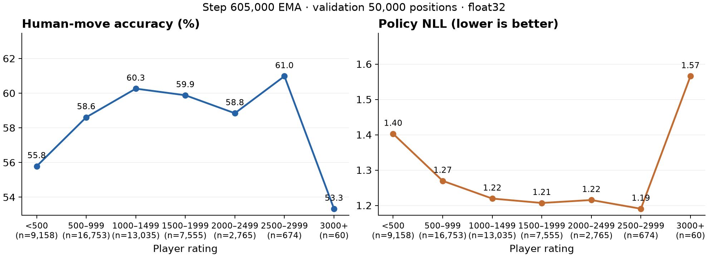
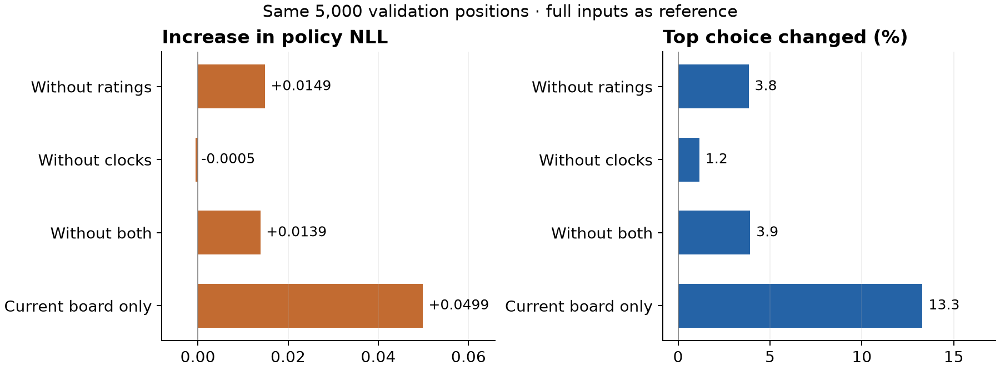

# shogi-human-policy

レーティング、残り持ち時間、局面履歴から、人間が次に指す手の確率を予測する将棋モデルです。
自分と相手の条件を変えた分析や、人間の着手傾向を利用するアプリケーションに使えます。

現在はローカル準備版です。
GitHubリポジトリと重みの配布先はまだ作成していません。
以下の性能は、学習途中の **605,000更新EMA** を固定して測定したものです。

## 推論を試す

Python 3.11〜3.13を使用します。
`uv`で依存関係をインストールします。

```console
uv sync
uv run shogi-human-policy predict --model models/preview-step-0605000 --position "startpos moves 7g7f 3c3d" --self-rating 1500 --opponent-rating 1800 --self-time-seconds 90 --opponent-time-seconds 60 --top-k 5
```

`models/preview-step-0605000/`にはローカルで準備した`manifest.json`と`policy.safetensors`を配置しています。
重みはGitに含めません。
別のPCで使う場合は、この2ファイルを同じディレクトリへコピーします。
読み込み時にSHA-256とモデル構造を照合します。

```python
from shogi_human_policy import Conditions, PolicyModel, Position

model = PolicyModel.from_directory("models/preview-step-0605000")
position = Position.from_usi("startpos moves 7g7f 3c3d")
result = model.predict(
    position,
    Conditions(ratings=(1500, 1800), clocks=(90, 60)),
    top_k=5,
)
for move in result.moves:
    print(move.usi, move.probability)
```

レーティングと時計は、それぞれ自分、相手の順です。
`Conditions()`なら両方不明、`Conditions(ratings=(1500, 1800))`なら時計だけ不明として推論できます。
各組は2人分を一緒に指定または省略します。
既知の0秒と、不明な時間は区別されます。

時計は **着手を選ぶ前に利用可能な秒数** を入力します。
本時間と秒読みのある対局なら、その時点の本時間と利用可能な秒読みを合算します。
フィッシャーの次回加算を先取りせず、実際の対局ルールに従って算出してください。
詳しくは[入力仕様](docs/inference.md)を参照してください。

## 性能と入力の効果

[評価結果](docs/evaluation.md)に、棋力帯別の正解率とpolicy loss、手数帯別の精度、条件と履歴の省略による変化を掲載します。
対局単位で学習から除外したvalidationを使用し、未使用testは使いません。
正解率は実際の人間の着手との一致率で、対局時の勝率や棋力保証ではありません。

| 評価対象 | 人間の着手との一致率 | policy NLL |
|---|---:|---:|
| 自然頻度のvalidation 50,000局面 | 58.75% | 1.2677 |





## モデル

盤面81マスと持ち駒14種類を扱う95 tokenのTransformerです。
最大8局面の履歴を入力し、自分と相手のレーティング、時計、条件の既知性をAdaLNへ渡します。
合法手のlogitをsoftmaxし、USI形式の着手と確率を返します。
`top_k`で上位だけ返す場合も確率は全合法手を分母とし、再正規化しません。

学習では条件をランダムに省略し、履歴もランダムに短縮しています。
現在局面しか分からない場合も利用できますが、可能なら初期局面と着手列を渡してください。
valueは今回の人間棋譜で学習していないため、配布形式とAPIには含めていません。

[モデルの来歴](docs/model-card.md) / [入力仕様](docs/inference.md) / [配布形式](docs/model-format.md)

## 開発

```console
uv sync --group dev --group analysis
uv run pytest
uv run ruff check .
uv run ruff format --check .
uv build
```

推論に学習リポジトリ、JAX、Flax、TPU、棋譜DBは不要です。
CPUのfloat32を検証対象にしています。
PyTorchでデバイスを指定できますが、CUDAでの数値と速度は未測定です。

公開前に、コードとモデル重みのライセンス、重みの配布先、最終モデルでの再評価を確定します。
