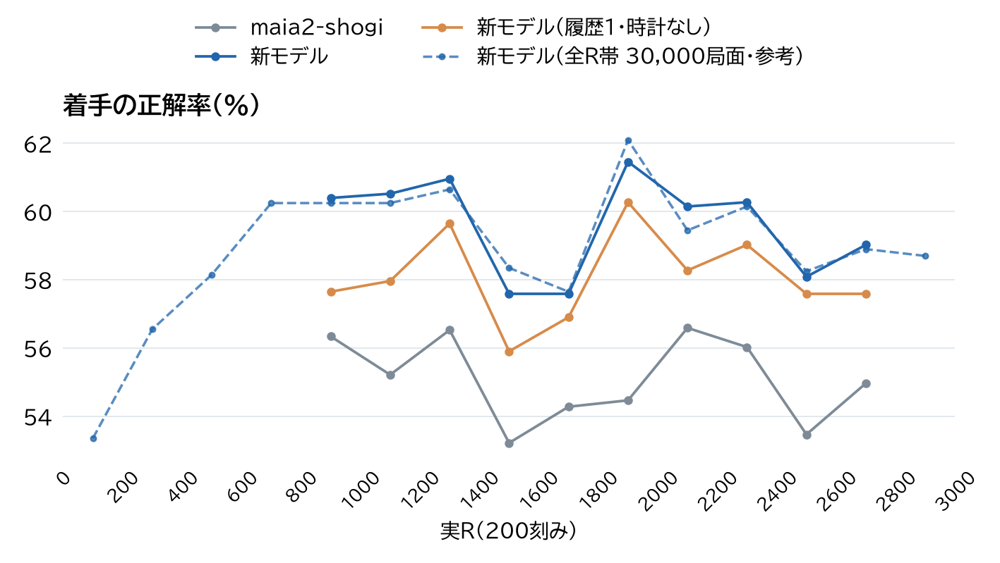
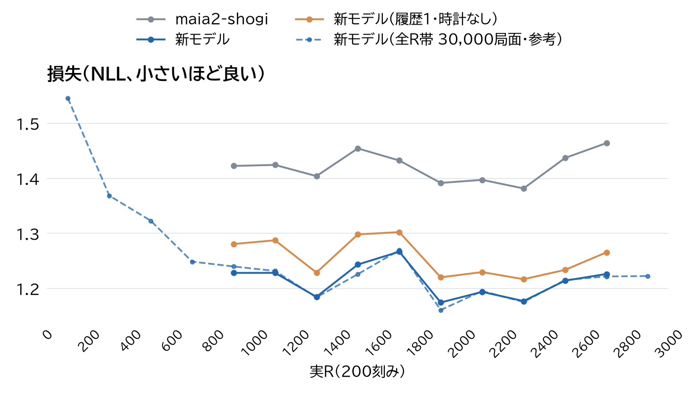

# shogi-human-policy

レーティング（R）、残り持ち時間、最大8局面の履歴から、人間が次に指す手の確率分布を予測する将棋モデルです。棋譜の途中局面を調べたり、入力Rを変えて着手傾向の違いを比較したりできます。

作者の前作 [nyoki-mtl/maia2-shogi](https://github.com/nyoki-mtl/maia2-shogi) に続く取り組みで、`rsshogi-az` の学習済み重みを出発点に R と時計を AdaLN で条件付けしています。

> [!NOTE]
> 現在はローカル準備版（`v0.1.0-preview`）です。GitHubリポジトリと重みの配布先はまだ公開していません。

## クイックスタート

Python 3.11〜3.13 で動作します（学習環境・JAX・TPU・棋譜DBは不要です）。

### CLI で試す

モデルディレクトリ（`manifest.json` と `policy.safetensors` の2ファイル）を用意して実行します。

```console
uv sync
uv run shogi-human-policy predict --model models/v0.1.0-preview --position "startpos moves 7g7f 3c3d"
uv run shogi-human-policy predict --model models/v0.1.0-preview --file examples/records/opening.kif --ply 2 --top-k 5
```

| 入力できる情報 | CLI オプション例 |
|---|---|
| 平手初期局面・SFEN・着手列 | `--position "startpos moves 7g7f 3c3d"` / `--position "<SFEN> moves ..."` |
| 棋譜ファイル（KIF / KIFU / KI2 / CSA） | `--file game.kif` |
| 棋譜の途中局面 | `--file game.kif --ply 30`（`0` は開始局面、省略時は末尾） |
| 機械処理向け JSON 出力 | `--format json` |

> 履歴も予測に使うため、SFEN 単体よりも棋譜ファイルや着手列を渡す方が精度が上がります。

### Python から使う

```python
from shogi_human_policy import Conditions, PolicyModel, Position

model = PolicyModel.from_directory("models/v0.1.0-preview")
position = Position.from_file("examples/records/opening.kif", ply=2)

result = model.predict(
    position,
    Conditions(ratings=(1500, 1800)),  # (手番側R, 相手R)。時計は不明。
    top_k=5,
)
for row in result.as_rows(position):
    print(row["notation"], row["usi"], f"{row['probability']:.2%}")
```

- `Position.from_sfen(sfen, moves=[...])` や `Position.from_usi("startpos moves ...")` も利用できます。
- `Conditions()` のみなら R・時計とも不明として推論します。時計を指定する場合は `clocks=(手番側の利用可能秒数, 相手の利用可能秒数)` を渡します（本時間＋秒読みの合計。当該手の消費時間は含めません）。
- R と時計はそれぞれ2人分まとめて指定または省略します。棋譜ヘッダからの自動推定は行いません。

### Colab デモで試す

[notebooks/demo.ipynb](notebooks/demo.ipynb) を Google Colab（標準 CPU ランタイム / Python 3.11〜3.13）へアップロードして実行できます。

1. ローカルで `uv build --wheel` を実行する。
2. 最初のセルで wheel、`manifest.json`、`policy.safetensors` の3ファイルをアップロードする。
3. 局面（SFEN / USI / 棋譜ファイル）と先手・後手の R / 時計を指定して実行すると、盤面と上位候補が表示されます。

---

## 予測性能（`v0.1.0-preview`）

数値はすべて **temperature 1・全合法手を分母とした正規化** で算出しています。policy 一致率は指定 R での対局棋力やレーティング校正を保証するものではありません。

### 全体成績と前作との比較

| 評価設定（validation） | モデル | 正解率 | policy NLL |
|---|---|---:|---:|
| 自然頻度 50,000局面 | 本モデル | **58.75%** | **1.2677** |
| 前作との共通範囲 16,010局面 | `maia2-shogi v0.2.1` | 55.11% | 1.4211 |
| 前作との共通範囲 16,010局面 | 本モデル | **59.61%** (+4.50pt) | **1.2138** (-0.2073) |

- **入力の寄与**（自然頻度 5,000局面）：R を省略すると NLL が `+0.0149`、履歴を省略（現在局面のみ）すると `+0.0499` 悪化します。
- **手数帯別の比較**（共通範囲 16,010局面）：20手以降は全帯で本モデルが改善（40〜79手 +6.84pt、80手以降 +8.39pt）。ただし 0〜19手の NLL は `maia2-shogi` の方が良好でした。





実線は共通範囲 16,010局面（R 800〜2799）での同一局面比較、破線は全 R 帯 30,000局面（R 0〜2999）における本モデルの参考値です。800〜2799 の全帯で正解率と NLL が改善しています（詳細は [maia2-shogi との同一局面比較](docs/direct-comparison.md)）。

### 入力Rに対する応答


R帯（200刻み）と手数帯の内訳を揃えた validation 30,000局面（各帯 2,000局面）での結果です。丸印は各実 R 帯で標本上最良だった入力帯を示します。低 R 帯では低い入力 R、高 R 帯では高い入力 R で正解率が高まる傾向が確認できます。

### 詳細レポート

- [評価結果と入力R応答](docs/evaluation.md) — 全体・R帯別・手数帯別の性能、入力省略の効果、実R×入力Rマトリクス、高R帯（2800〜2999）の確認
- [maia2-shogi との同一局面比較](docs/direct-comparison.md) — 公開 v0.2.1 との R帯別・手数別・R応答の直接比較
- [論文（GPW2026）に対応した詳細分析](docs/paper-analysis.md) — 一致パターン、順位別/着手別 JSD、確率校正（ECE）、入力対照実験

---

## モデル仕様と利用範囲

- **構造**: `rsshogi-az` 由来の 95 token Transformer + AdaLN（14,723,681 パラメータ）、最大8局面の履歴を入力
- **出力**: 全合法手に対する確率分布（上位候補だけを表示しても再正規化しません）
- **対象外**: value 予測・探索・投了判断・時間配分を行う USI エンジン機能は含みません
- **想定尺度**: R は学習元の将棋倶楽部24の尺度を想定しており、他サービスへの換算は未検証です

詳細は以下を参照してください。

- [入力仕様・API・配布形式](docs/inference.md) — 局面・棋譜の扱い、Rと時計の定義、バッチ推論、`manifest.json` + `policy.safetensors` 仕様
- [モデルカード](docs/model-card.md) — 学習元データ、条件 dropout・履歴短縮、数値検証範囲、公開前の未確定事項

## 開発

```console
uv sync --group dev --group analysis
uv run pytest
uv run ruff check .
uv run ruff format --check .
uv build
```
