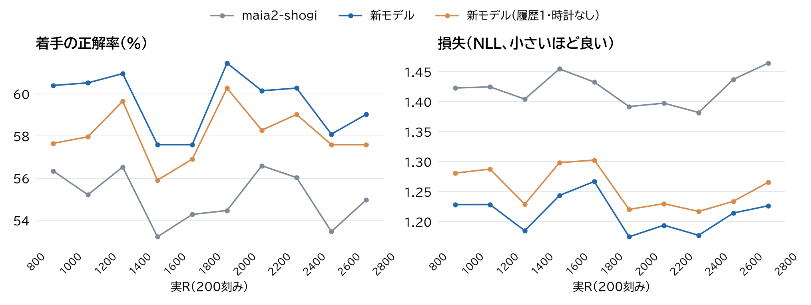
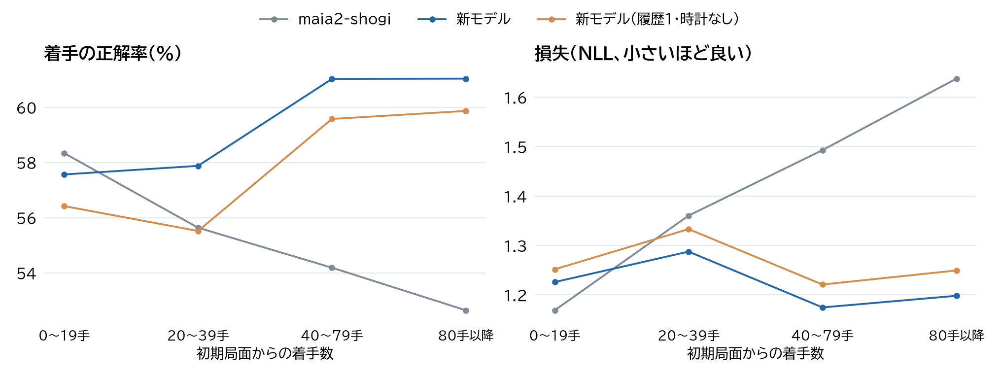
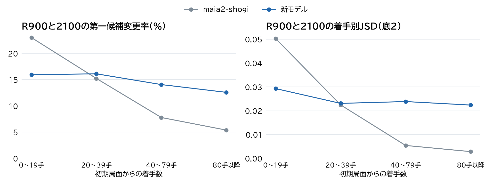

# maia2-shogi との同一局面比較

[README に戻る](../README.md)

作者の前作 [nyoki-mtl/maia2-shogi](https://github.com/nyoki-mtl/maia2-shogi)（公開 v0.2.1）と本モデル（`preview-step-0605000` EMA）を、**同一の 16,010 局面（6,984 対局）・同一の合法手集合・temperature 1・全合法手正規化** で比較しました。

> [!NOTE]
> - 公開 `maia2-shogi` の元学習データは手元にないため、同モデルに対する完全な未学習データであることは保証できません（本モデルに対しては学習と対局分離済みの validation です）。
> - 両モデルで構造・事前学習・学習データ・更新数が異なるため、改善の要因を履歴や AdaLN 単体に帰属するものではありません。また、対局棋力の比較は行っていません。

---

## 全体の予測性能

| モデル | 正解率 | policy NLL |
|---|---:|---:|
| `maia2-shogi v0.2.1` | 55.11% | 1.4211 |
| 本モデル（通常入力） | **59.61%** | **1.2138** |
| 本モデル（履歴1・時計なし） | 58.08% | 1.2565 |

- 通常入力の本モデルは、正解率で **+4.50 pt**（95% 区間: +3.85〜+5.14 pt）、NLL で **-0.2073**（95% 区間: -0.2201〜-0.1949）改善しました。
- 過去履歴と時計を省略しても、正解率で +2.97 pt、NLL で -0.1646 上回りました。

---

## R 帯別比較

自他 R に観測値を入力した結果、評価した全 10 帯（800〜2799）で本モデルの平均一致率と NLL が改善しました。

| 実 R 帯 | Maia 正解率 | 本モデル正解率 | Maia NLL | 本モデル NLL |
|---|---:|---:|---:|---:|
| 800〜999 | 56.34% | **60.40%** | 1.4227 | **1.2283** |
| 1000〜1199 | 55.22% | **60.52%** | 1.4246 | **1.2284** |
| 1200〜1399 | 56.53% | **60.96%** | 1.4043 | **1.1848** |
| 1400〜1599 | 53.22% | **57.59%** | 1.4545 | **1.2436** |
| 1600〜1799 | 54.28% | **57.59%** | 1.4326 | **1.2669** |
| 1800〜1999 | 54.47% | **61.46%** | 1.3918 | **1.1746** |
| 2000〜2199 | 56.59% | **60.15%** | 1.3974 | **1.1939** |
| 2200〜2399 | 56.03% | **60.27%** | 1.3818 | **1.1772** |
| 2400〜2599 | 53.47% | **58.09%** | 1.4371 | **1.2143** |
| 2600〜2799 | 54.97% | **59.03%** | 1.4642 | **1.2264** |

---

## 手数帯別比較

| 初期局面からの着手数 | Maia 正解率 | 本モデル正解率 | Maia NLL | 本モデル NLL |
|---|---:|---:|---:|---:|
| 0〜19 手 | **58.34%** | 57.56% | **1.1686** | 1.2257 |
| 20〜39 手 | 55.63% | **57.88%** | 1.3602 | **1.2873** |
| 40〜79 手 | 54.19% | **61.03%** | 1.4929 | **1.1743** |
| 80 手以降 | 52.64% | **61.04%** | 1.6375 | **1.1979** |

- **0〜19 手の NLL は `maia2-shogi` の方が良好**（差 +0.0571、95% 区間: +0.0400〜+0.0741）でした（一致率差は -0.77 pt で 95% 区間は 0 をまたぎます）。
- **20 手以降**は本モデルが両指標で上回り、特に 40〜79 手で一致率 +6.84 pt、80 手以降で +8.39 pt 改善しました。

---

## 入力 R への反応の比較

相手 R を観測値に保ち、自分の入力 R だけを `900` / `1600` / `2100` へ変更して比較しました。

| R900 と R2100 の比較 | `maia2-shogi` | 本モデル |
|---|---:|---:|
| 第一候補変更率 | 12.23% | **15.64%** |
| 平均 TV | 0.09127 | **0.13129** |
| 着手別 JSD（底 2） | 0.01831 | **0.02817** |
| 順位別 Top-5 JSD（底 2） | 0.00899 | **0.01386** |

- 全体の第一候補変更率は本モデルが +3.41 pt（95% 区間: +2.73〜+4.08 pt）上回りました。手数別に見ると、0〜19 手は `maia2-shogi`（23.01% vs 17.51%）の方が大きく、80 手以降は本モデル（5.38% vs 13.95%）の方が反応が維持されています。
- 自 R を 1600 固定から観測値に戻したときの NLL 改善幅は、`maia2-shogi` が **0.0159**（95% 区間: 0.0132〜0.0187）、本モデルが **0.0354**（95% 区間: 0.0319〜0.0388）でした。

---

## 測定条件と集計データ

- **抽出方法**: 既存の均等化 validation（30,000 局面）のうち、自他 R がともに 800 以上 2800 未満の局面から、10 の自 R 帯ごとに 20 手刻みの手数構成を揃えて各帯 1,601 局面（計 16,010 局面）を非復元抽出しました。
- **モデル変換**: `maia2-shogi` は 119 特徴量＋100 刻み R カテゴリに変換して ONNX で推論し、両モデルのラベル（2187 / 1496）を同じ USI 合法手集合へ対応させています。
- **区間推定**: 対局単位 bootstrap 2,000 回による個別 95% 区間です（同一プレイヤーの相関と多重比較は未補正）。
- **集計 JSON / 図の再生成**: [集計 JSON](metrics/preview-step-0605000-direct-maia2.json) から `uv run python tools/plot_direct_comparison.py docs/metrics/preview-step-0605000-direct-maia2.json` で図を再生成できます。
