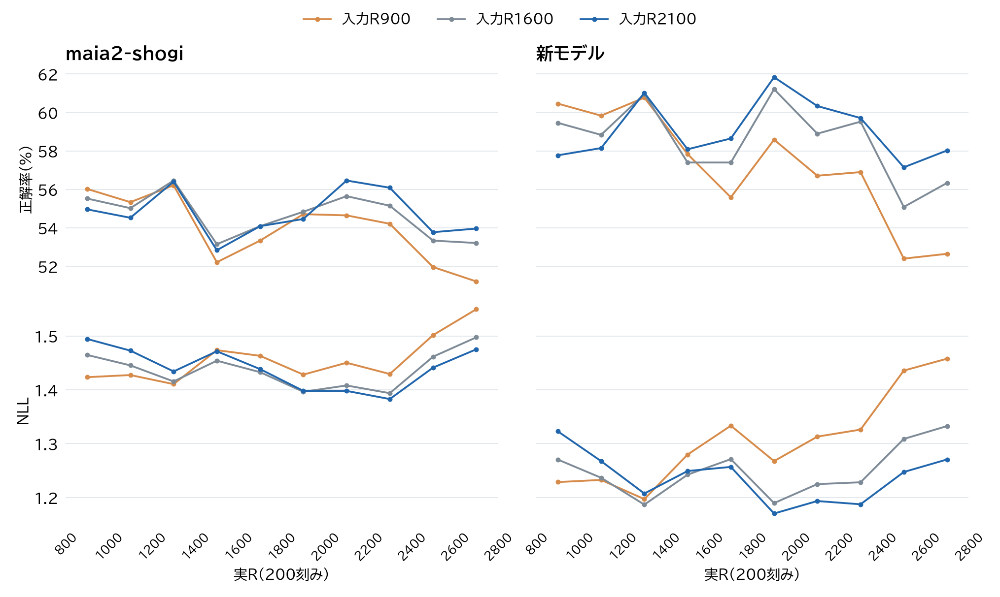

# maia2-shogiとの同一局面比較

共通の入力範囲で、同じ16,010局面、同じ合法手集合、同じ教師着手を使って比較しました。
新モデルは605,000更新EMAです。
800以上2800未満を200刻みに区切り、全10帯で各1,601局面、20手刻みの内訳も揃えています。

公開maia2-shogiの元学習データがないため、同モデルに対して完全な未使用データとは保証できません。
新モデルに対しては、学習と着手列単位で分離済みのvalidationです。

## 全体の予測性能

| モデル | 正解率 | NLL |
|---|---:|---:|
| maia2-shogi v0.2.1 | 55.11% | 1.4211 |
| 新モデル（通常入力） | 59.61% | 1.2138 |
| 新モデル（履歴1・時計なし） | 58.08% | 1.2565 |

通常入力の新モデルは、一致率が**+4.50ポイント**、NLLが**-0.2073**改善しました。
対局単位の95%区間は、一致率差+3.85〜+5.14ポイント、NLL差-0.2201〜-0.1949です。
過去局面と時計を省略しても、maia2-shogiより平均一致率が約2.97ポイント高く、NLLも0.1646小さくなりました。
この対照にも新モデルの手数特徴は残り、構造、事前学習、学習データや更新数を揃えた比較ではありません。
改善の原因を履歴やAdaLNの単独効果には帰属しません。

## R帯別

全10帯で、新モデルの平均一致率とNLLが改善しました。
以下は観測された自他Rを入力した結果です。

| 実R帯 | Maia一致率 | 新モデル一致率 | Maia NLL | 新モデルNLL |
|---|---:|---:|---:|---:|
| 800〜999 | 56.34% | 60.40% | 1.4227 | 1.2283 |
| 1000〜1199 | 55.22% | 60.52% | 1.4246 | 1.2284 |
| 1200〜1399 | 56.53% | 60.96% | 1.4043 | 1.1848 |
| 1400〜1599 | 53.22% | 57.59% | 1.4545 | 1.2436 |
| 1600〜1799 | 54.28% | 57.59% | 1.4326 | 1.2669 |
| 1800〜1999 | 54.47% | 61.46% | 1.3918 | 1.1746 |
| 2000〜2199 | 56.59% | 60.15% | 1.3974 | 1.1939 |
| 2200〜2399 | 56.03% | 60.27% | 1.3818 | 1.1772 |
| 2400〜2599 | 53.47% | 58.09% | 1.4371 | 1.2143 |
| 2600〜2799 | 54.97% | 59.03% | 1.4642 | 1.2264 |

## 手数別

| 初期局面からの着手数 | Maia一致率 | 新モデル一致率 | Maia NLL | 新モデルNLL |
|---|---:|---:|---:|---:|
| 0〜19手 | 58.34% | 57.56% | 1.1686 | 1.2257 |
| 20〜39手 | 55.63% | 57.88% | 1.3602 | 1.2873 |
| 40〜79手 | 54.19% | 61.03% | 1.4929 | 1.1743 |
| 80手以降 | 52.64% | 61.04% | 1.6375 | 1.1979 |

**0〜19手のNLLはmaia2-shogiの方が良い**結果でした。
新モデルのNLL差は+0.0571、95%区間は+0.0400〜+0.0741です。
この手数帯の一致率差は-0.77ポイントで、95%区間は0をまたぎます。
20手以降は新モデルの両指標が改善し、40〜79手で一致率+6.84ポイント、80手以降で+8.39ポイントでした。
全体で優れていても、全ての手数帯で優れるわけではありません。

## 入力Rへの反応

相手Rを観測値に保ち、自Rだけを900、1600、2100へ変更しました。
両モデルでまったく同じ局面とRの組を使い、温度1、全合法手で正規化しています。

| R900と2100の比較 | maia2-shogi | 新モデル |
|---|---:|---:|
| 第一候補変更率 | 12.23% | 15.64% |
| 平均TV | 0.09127 | 0.13129 |
| 着手別JSD（底2） | 0.01831 | 0.02817 |
| 順位別Top-5 JSD（底2） | 0.00899 | 0.01386 |

第一候補変更率のモデル差は+3.41ポイント、対局単位95%区間は+2.73〜+4.08ポイントでした。
公開モデルにもRへの反応はあり、新モデルで反応がさらに強くなる結果です。
ただし手数別には、0〜19手の第一候補変更率はMaia 23.01%、新モデル17.51%で、Maiaの方が大きくなっています。
80手以降はMaia 5.38%、新モデル13.95%で、新モデルでは手数が進んでも反応が残る点が違います。
反応の強さだけでなく、観測自Rを使うことが予測に有益かも確認しました。

| 自R1600固定から観測自Rに戻したNLL改善 | 改善幅 | 95%区間 |
|---|---:|---:|
| maia2-shogi v0.2.1 | 0.0159 | 0.0132〜0.0187 |
| 新モデル（通常入力） | 0.0354 | 0.0319〜0.0388 |

両モデルとも、観測自Rを与えるとNLLが改善します。
今回の集合では、その改善幅は新モデルの方が大きい結果でした。
これは実Rの予測への寄与で、指定Rでの対局棋力や単調な強さの保証ではありません。

## 測定条件

評価元は既存のR帯と手数帯を揃えた30,000 validation局面です。
そのうち自他Rがともに800以上2800未満の19,203局面から、10の自R帯ごとに同じ手数枠で非復元抽出しました。
抽出seedは20261120、合計16,010局面、6,984対局です。
各R帯の20手ごとの9枠は349、339、343、271、197、76、16、8、2局面です。
800未満、2800以上、不明なRを丸めて公開モデルへ入力することはしていません。
手数は0〜19、20〜39、40〜79、80以降で集計しています。
これらは局面構造による序中終盤の分類ではありません。

公開版はv0.2.1のONNXと公開推論コードの119特徴量を用い、100刻みのRカテゴリへ変換しました。
新モデルの手番側へ正規化された現在盤面と持ち駒から、同一盤面を復元しました。
全16,010局面で、rsshogiとcshogiの合法USI着手集合、各ラベルの一意性、元のcompact合法手集合と教師の合法性を照合しました。
先後、成り、捕獲と持ち駒を含む別標本でも、原盤面と正規化盤面で公開特徴量が完全一致しました。
2187ラベルと1496ラベルを同じUSI着手へ対応させ、同じ合法手集合でsoftmaxを計算しています。

公開モデルはONNX Runtime 1.24.4のDirectML float32、新モデルはPyTorch 2.11.0のCUDA float32、TF32無効です。
公開モデルの選択集合64局面×4条件でCPUとDirectMLを比較し、教師NLLの最大差0.000317未満、第一候補は全256入力で一致しました。
新モデルの通常入力とR介入は同じ重みと同じ局面の既存推論cacheを再利用しています。
履歴1、時計なしの対照だけを追加推論しました。
この対照は時計の既知性maskを0にし、過去フレームをゼロ埋めし、repetitionを0にします。
現在盤面、持ち駒、自他Rと手数特徴は保持しています。

区間は対局単位で対応を保つbootstrap 2,000回、seed 20261120による個別95%区間です。
同一プレイヤーの相関と多重比較は補正していません。
R帯と手数を揃えた集合の平均であり、DB全体の自然頻度平均ではありません。
公開Maiaの学習原本がないため、同モデルに対する学習データとの非重複は確認できません。
対局による勝率や棋力差は今回測定していません。

[集計JSON](metrics/preview-step-0605000-direct-maia2.json) / [新モデルのR応答](rating-response.md) / [論文に対応する分析](paper-analysis.md)

再現用の抽出、入力変換、実行と集計コードはtrainerの`scripts/experiments/compare_public_maia2.py`です。
公開モデルや元DBを変更せず、個別局面、対局ID、変換入力と予測cacheはprivateなwork_dirに保持しています。
図は`tools/plot_direct_comparison.py`で集計JSONから再生成できます。
