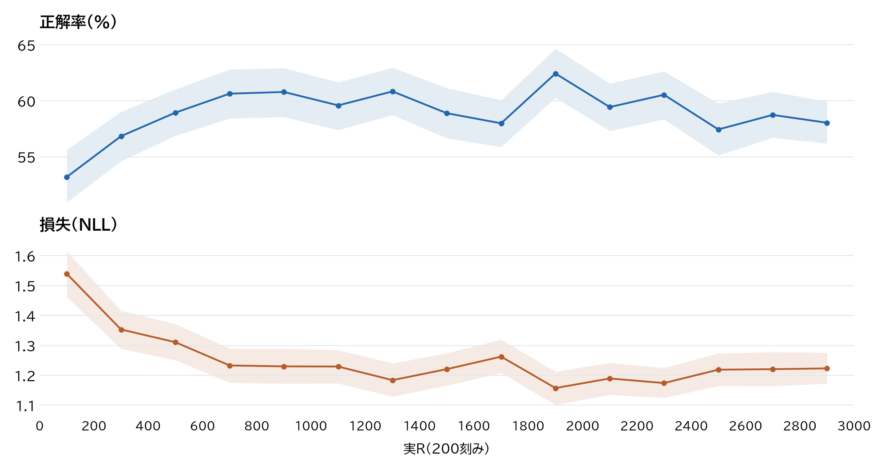
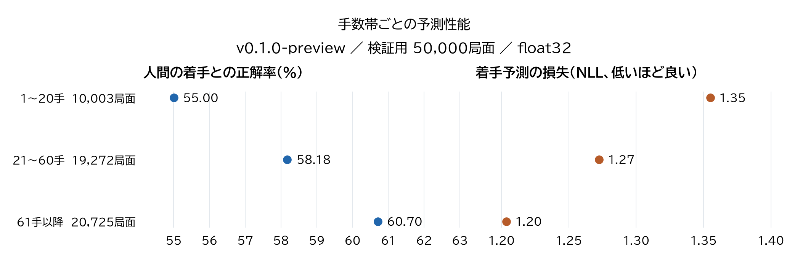
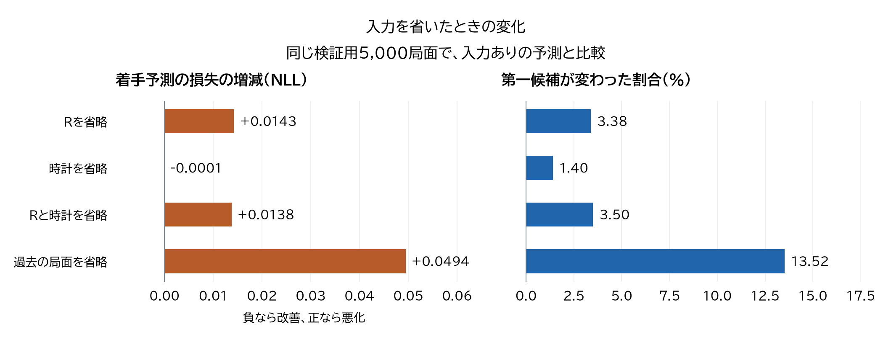
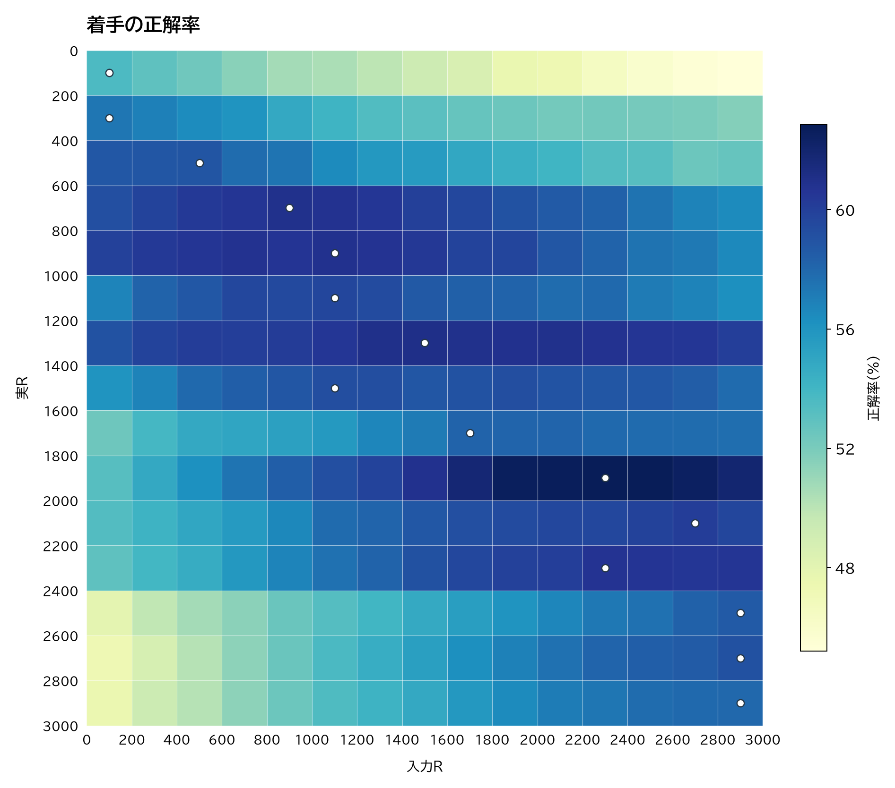
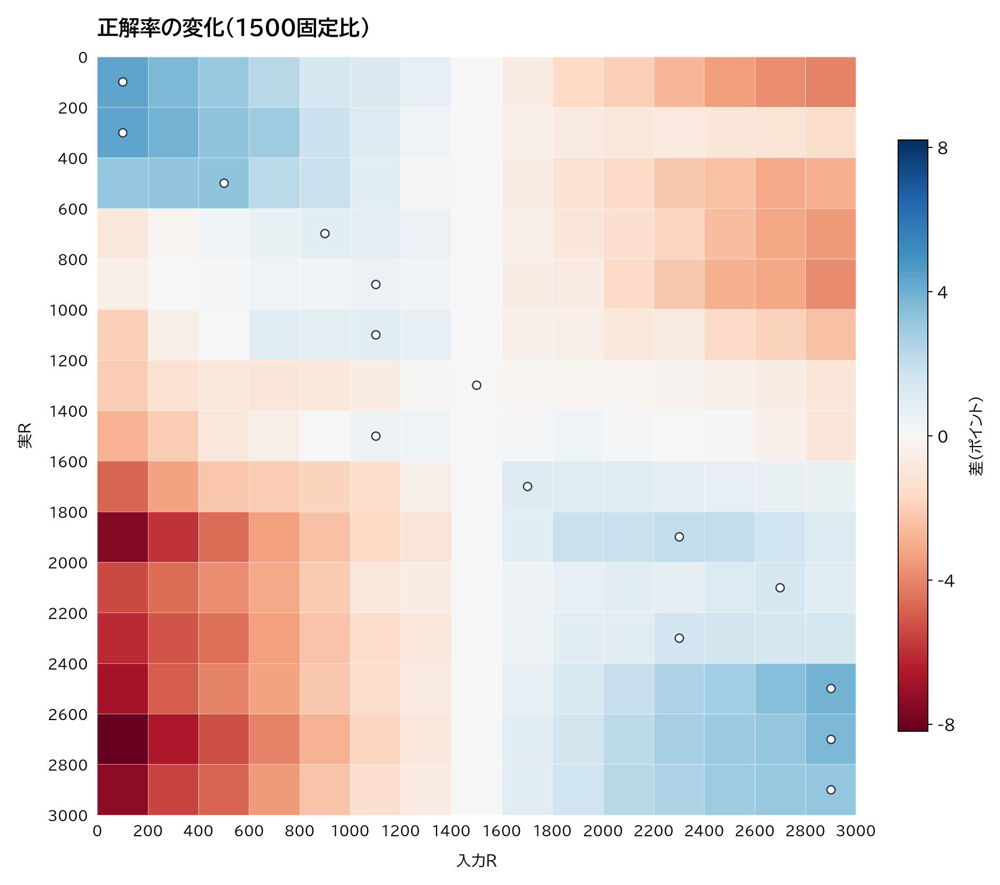
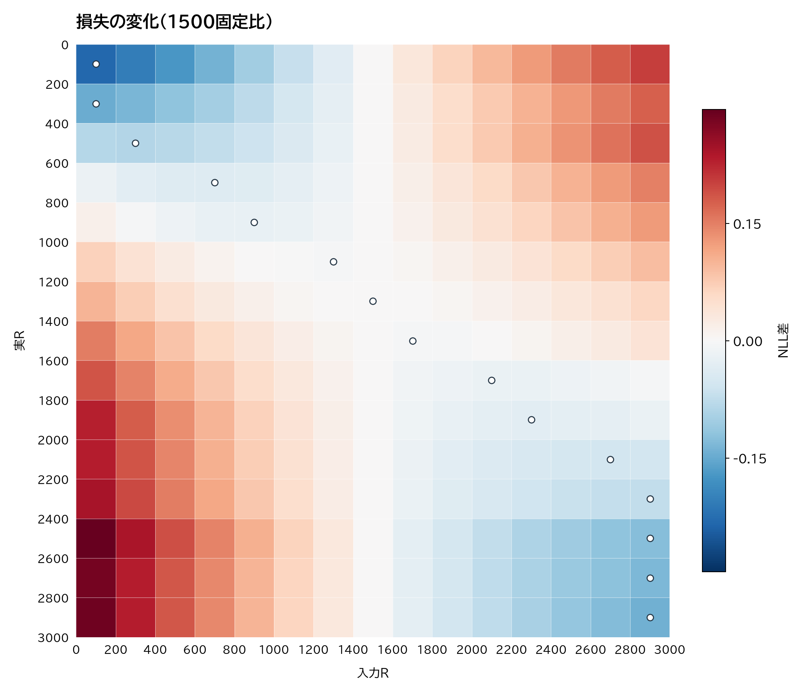
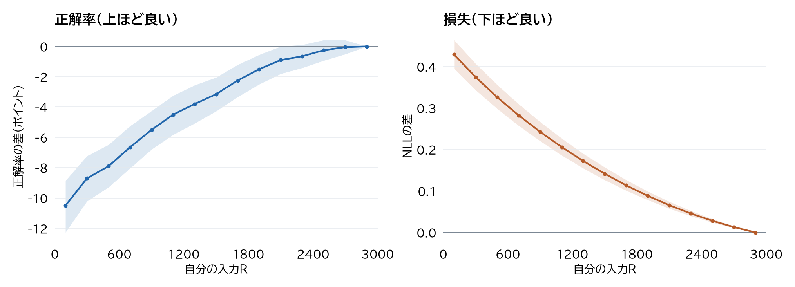

# 評価結果と入力R応答

[README に戻る](../README.md)

対象は `v0.1.0-preview`（EMA）です。すべての評価は **temperature 1・全合法手を分母とした正規化・局面等重み** で行い、対局単位で学習データと分離した validation 集合を使用しています（test 集合は未使用）。なお、これらの数値はモデルの一致率や入力感度を示すものであり、指定 R での対局棋力やレーティング校正を保証するものではありません。

## 全体成績（自然頻度 50,000 局面）

| 評価集合 | 局面数 | 正解率 | policy NLL | entropy |
|---|---:|---:|---:|---:|
| 自然頻度 validation | 50,000 | 58.590% | 1.260381 | 1.238813 |

- **正解率**: 最上位の合法手と人間の指し手が一致する割合
- **policy NLL**: 実際の着手に与えた確率の負の自然対数平均（小さいほど良い）
- **第一候補変更率 / JS divergence**: 条件変更時に最上位手が変わる割合と分布間距離（本ページでは自然対数）

---

## 棋力帯別・手数帯別の性能





- **棋力帯別（上図）**: 0〜2999 を 200 刻みにし、各帯 2,000 局面（計 30,000 局面）で 20 手刻みの手数帯構成比を揃えた validation 標本です。観測された自他 R・時計・最大 8 局面の履歴を入力し、陰影は対局単位 bootstrap（2,000 回）の 95% 区間を示します。
- **手数帯別（下図）**: 冒頭の自然頻度 50,000 局面を 1〜20 手・21〜60 手・61 手以降で集計したものです（戦型等による序中終盤の分類ではありません）。2つの評価集合は分布が異なるため平均値を直接比較しません。

---

## 入力条件と履歴の寄与

自然頻度 50,000 局面から固定 seed で抽出した 5,000 局面（基準：正解率 58.72%、NLL 1.241944）を用い、同一局面で各入力を省略した変化を測定しました。



| 省略した情報 | NLL の変化 | 第一候補変更率 |
|---|---:|---:|
| R | +0.014263 | 3.38% |
| 時計 | -0.000077 | 1.40% |
| R と時計 | +0.013757 | 3.50% |
| 過去の局面（現在局面のみ） | +0.049448 | 13.52% |

R と過去履歴の省略は NLL を悪化させました。時計省略の差は小さく、この標本からは時計の寄与を確定できません。

### 自分と相手の R を個別に変更した場合

上記 5,000 局面のうち R が既知の 2,000 局面で、片方の R だけを `500` から `2500` へ変更しました。

| 変更対象（500 → 2500） | 局面数 | 第一候補変更率 | JS divergence |
|---|---:|---:|---:|
| 自分の R | 2,000 | 21.40% | 0.0373 |
| 相手の R | 2,000 | 15.20% | 0.0204 |

自分と相手の双方の R に応じて予測分布が変化します。

---

## 実Rと入力Rの対応（30,000 局面）

棋力帯別と同じ 30,000 局面（15 帯 × 2,000 局面）を用い、相手 R・時計・履歴を観測値に固定したまま、**自分の入力 R だけ**を各帯の中央値（100, 300, ..., 2900）へ変えて評価しました。



[拡大用 SVG](assets/rating-input-accuracy.svg)





### 各実 R 帯で最良だった入力 R 帯（記述統計）

| 実際の R 帯 | 対局数 | 正解率が最高の入力 R 帯 | NLL が最小の入力 R 帯 |
|---|---:|---|---|
| 0〜199 | 497 | 0〜199 | 0〜199 |
| 200〜399 | 1,317 | 0〜199 | 0〜199 |
| 400〜599 | 1,403 | 400〜599 | 200〜399 |
| 600〜799 | 1,454 | 800〜999 | 600〜799 |
| 800〜999 | 1,417 | 1000〜1199 | 800〜999 |
| 1000〜1199 | 1,280 | 1000〜1199 | 1200〜1399 |
| 1200〜1399 | 1,332 | 1400〜1599 | 1400〜1599 |
| 1400〜1599 | 1,189 | 1000〜1199 | 1600〜1799 |
| 1600〜1799 | 1,062 | 1600〜1799 | 2000〜2199 |
| 1800〜1999 | 912 | 2200〜2399 | 2200〜2399 |
| 2000〜2199 | 743 | 2600〜2799 | 2600〜2799 |
| 2200〜2399 | 462 | 2200〜2399 | 2800〜2999 |
| 2400〜2599 | 265 | 2800〜2999 | 2800〜2999 |
| 2600〜2799 | 140 | 2800〜2999 | 2800〜2999 |
| 2800〜2999 | 72 | 2800〜2999 | 2800〜2999 |

### 高レート帯（R2800〜2999）での確認

実 R 2800〜2999 の 2,000 局面（72 対局）では、正解率は入力 R 2900 で 58.00%、NLL は入力 R 2900 で 1.2217 が最良でした（陰影は対局単位 bootstrap の 95% 区間）。



| 入力 R | 正解率 | NLL | 正解率差（2900 比）95% 区間 |
|---:|---:|---:|---:|
| 1500 | 54.85% | 1.3631 | -4.27〜-2.04 pt |
| 1700 | 55.75% | 1.3351 | -3.34〜-1.21 pt |
| 1900 | 56.50% | 1.3098 | -2.50〜-0.55 pt |
| 2500 | 57.75% | 1.2498 | -0.93〜+0.42 pt |
| 2900 | 58.00% | 1.2217 | 基準 |

---

## 集計データと再生成

- 集計 JSON: [全体・入力省略 JSON](metrics/v0.1.0-preview.json) / [実R×入力R マトリクス JSON](metrics/v0.1.0-preview-rating-matrix.json)
- R 帯別集計では 3000 以上および不明 R を除外しています。bootstrap 区間は対局単位の再抽出（2,000 回）であり、同一プレイヤーの相関や多重比較は補正していません。
- 評価用データセット（NPZ）は非配布ですが、手元の評価 NPZ を用意すれば以下のコマンドで再集計・再描画できます（図の再生成には日本語フォントが必要です）。

```console
uv sync --group analysis
uv run python tools/evaluate.py --model models/v0.1.0-preview --dataset /path/to/validation.npz --output docs/metrics/v0.1.0-preview.json
uv run python tools/evaluate_rating_matrix.py --model models/v0.1.0-preview --dataset /path/to/matched-validation.npz --selection-info /path/to/matched-validation.json --per-band 2000 --cache work_dir/matched-metrics.npz --output docs/metrics/v0.1.0-preview-rating-matrix.json
uv run python tools/plot_metrics.py docs/metrics/v0.1.0-preview.json --rating-matrix docs/metrics/v0.1.0-preview-rating-matrix.json
```
