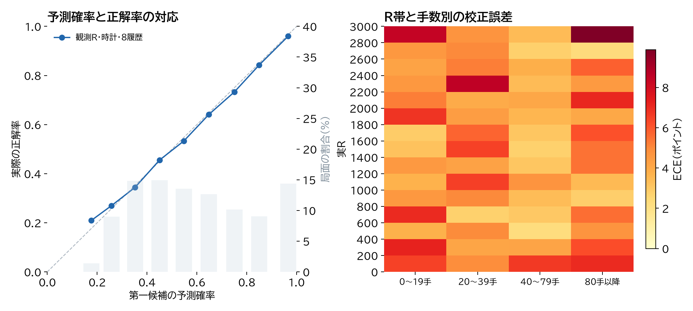
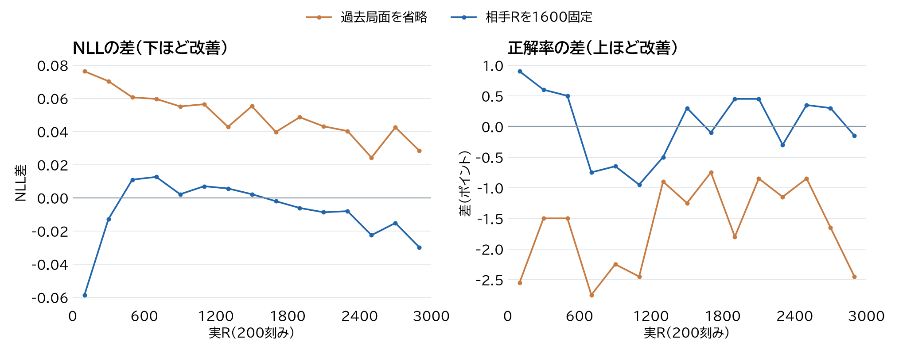

# 論文に対応した追加分析

605,000更新EMAを、R帯と手数帯を揃えたvalidation 30,000局面で分析しました。
0以上3000未満の200刻みで各2,000局面です。
未使用testは使っていません。

足立知己、竹内聖悟「Maia2におけるレート帯別モデルの一貫性と棋力差に関する分析」（GPW2026）の4.2〜4.5節に対応する指標です。
原論文とはモデル、データ、R帯の定義が異なるため、数値の厳密な追試ではありません。

## 入力Rの効果は手数が進んでも残る


実R2000〜2999をまとめたときの、入力R2100によるR900からの正解率改善は次の通りです。

| 初期局面からの着手数 | 正解率の改善 |
|---|---:|
| 0〜19手 | +4.15ポイント |
| 20〜39手 | +4.60ポイント |
| 40〜79手 | +4.54ポイント |
| 80手以降 | +4.06ポイント |

低R帯では低い入力Rの方がよく当たり、高R帯では高い入力Rの方がよく当たる傾向が各手数帯に残っています。
手数区分は局面構造による序中終盤の判定ではなく、図は点推定です。

観測Rを入力したときの手数別の成績です。

| 手数区分 | 局面数 | 正解率 | NLL |
|---|---:|---:|---:|
| 0〜19手 | 6,720 | 56.00% | 1.3009 |
| 20〜39手 | 6,645 | 57.16% | 1.3079 |
| 40〜79手 | 11,235 | 60.53% | 1.2150 |
| 80手以降 | 5,400 | 61.07% | 1.2180 |

今回の集合では、一致率が手数とともに一様に落ちる結果ではありません。
モデルと評価局面の分布が異なるため、論文との違いの原因までは特定していません。

低中高の入力Rを900、1600、2100とした比較で、各実R帯の最適値を示すものではありません。

## 正解率の差と、指し手自体の違い


低中高の順に、各入力Rで人間の手を当てれば1、外せば0とします。

| パターン | 局面の割合 |
|---|---:|
| 000 | 38.57% |
| 001 | 1.85% |
| 010 | 0.12% |
| 011 | 3.13% |
| 100 | 2.48% |
| 101 | 0.05% |
| 110 | 1.75% |
| 111 | 52.05% |

一部の条件だけ正解になる局面は**9.38%**、R900と2100で第一候補が変わる局面は**15.21%**でした。
3条件が同じ第一候補を選ぶ割合は84.66%です。
000は「3条件とも人間の手と違う」だけで、3条件が同じ手を選んだことは意味しません。
原論文で報告された約4%という一部条件のみ一致の割合と、今回の9.38%は、対象モデルと評価集合が違うため直接の性能比較には使いません。

## 順位別JSDと着手別JSDを分ける


| R900と2100の比較 | 平均JSD（底2） |
|---|---:|
| 上位5手の順位別確率 | 0.01388 |
| 全合法手の同じ着手を対応させた確率 | 0.02776 |

順位別は上位5つの確率を大きい順に並べ、合計1に再正規化した配列です。
同じ順位でも指し手が違う場合があり、着手別JSDとは別の指標です。
着手別は全合法手を同じ着手ラベルで対応させ、確率の形だけでなく指し手の変化も含めます。

| 手数区分 | 順位別JSDが0.01以上 | R900と2100で第一候補が変化 |
|---|---:|---:|
| 0〜19手 | 55.52% | 17.26% |
| 20〜39手 | 43.96% | 16.24% |
| 40〜79手 | 44.07% | 14.21% |
| 80手以降 | 42.00% | 13.48% |

序盤側で差が大きい傾向はありますが、80手以降にも入力Rによる変化が残っています。
順位別JSDが0.001以下の2,557局面でも、その4.38%でR900と2100の第一候補が違いました。
順位別の確率が似ているだけでは、指し手が同じとは言えません。

## 予測確率の校正



自他Rと時計を観測値にした8履歴の推論です。
全体の正解率は58.87%、Top-5は92.50%、NLLは1.2554、ECEは**0.96ポイント**でした。
ECEは第一候補の予測確率を0.1刻みに区切り、各区間の平均予測確率と正解率の絶対差を局面数で加重平均した値です。
全体の確率は正解率によく対応しますが、R帯と手数を絞ったECEにはずれと標本誤差が残ります。
層別ECEは標本数が少なく、全体ECEとの単純な大小比較で不良校正と断定しません。
小さなECEは、R条件の再現性や対局棋力を直接示すものではありません。

## 履歴と相手Rの対照



自Rを観測値に保ったまま、それぞれ片方の入力だけを変更しました。

| 条件 | NLL | 基準からのNLL差 | 差の95%区間 |
|---|---:|---:|---:|
| 全入力を観測値 | 1.2554 | 0 | 基準 |
| 相手Rだけ1600固定 | 1.2471 | -0.0082 | -0.0106〜-0.0059 |
| 現在局面だけ | 1.3049 | +0.0496 | +0.0458〜+0.0534 |

履歴省略はNLLを悪化させましたが、自R900と2100による第一候補変更は現在局面だけでも16.16%ありました。
履歴の利用とRへの反応は、どちらか一方に置き換わる関係ではありません。

一方、このsnapshotでは相手Rを1600固定した方が平均NLLは良い結果でした。
相手Rは出力に作用しますが、今回の条件で予測精度を高めているとは言えません。
1600固定は相手Rを欠損にした実験ではなく、全データで不要と結論する結果でもありません。
自Rまで1600へ強制すると相手R固定のNLL改善は0.0540と大きくなるため、反実仮想の自他Rの組合せを変える影響と、実Rでの予測性能を区別する必要があります。

## 測定条件と範囲

主比較は自R900、1600、2100、相手Rは観測値、時計と最大8局面の履歴を観測値に固定しています。
対照は相手R1600固定、または現在局面のみです。
現在局面のみでは過去フレームをゼロ埋めし、repetitionもその履歴内で数え直して0にします。
現在盤面、持ち駒、手数、Rと時計は維持します。

元の30,000局面の全特徴量と順序は既存matrix評価と同一で、初期手数からの着手数だけを付加しています。
全棋譜の元SFENの初期手数が1であることをDBで確認しました。
手数別の局面数は全R帯で448、443、749、360局面です。
各R帯の対局数、局面内容、相手Rと時計まで揃えた比較ではありません。

CUDA float32、TF32無効、全合法手正規化、温度1です。
JSDは論文に合わせ底2であり、以前の自然対数によるJSD値と混ぜません。
観測Rの基準推論は、既存matrixの独立した推論cacheと局面ごとのNLL、Top-1、entropyが完全一致しました。
2つの代表的なNLL差の区間は対局単位で対応を保つbootstrap 2,000回、seed 20261120です。
図のその他の値は記述統計です。
同一プレイヤーによる相関と多重比較は補正しておらず、最終testでの確認ではありません。

原論文は対局者の平均Rによる3帯で棋譜を分類し、相手Rにその帯の代表値を入れています。
今回は自Rの200刻みと観測相手Rを主比較にしており、モデルやデータも異なります。
論文のMaia-shogiとのモデル間比較と対局実験は、今回の605kモデルでは実施していません。
過去の37kモデルや公開Maiaの対局結果は流用していません。

[集計JSON](metrics/preview-step-0605000-paper-diagnostics.json) / [従来の入力R matrix](rating-response.md)

## 論文へのコメントに使える点

- このモデルでは、Rへの反応は80手以降にも残り、履歴省略でも消えません。
- 順位別JSDに加え、同じ着手を対応させたJSDと第一候補変更率を測ると、指し手そのものの違いを確認できます。
- 相手Rへの入力感度と、相手Rが予測精度に有益かどうかは別の検査です。
- 校正、一致率、R応答と対局棋力は別々に評価する必要があります。

## 再生成

追加データは既存のmatched validationの特徴量を維持し、元棋譜から求めた`local_ply`を付けたNPZです。
個別局面と対局IDを含む入力とcacheは公開しません。

```console
uv run python tools/evaluate_paper_diagnostics.py --model models/preview-step-0605000 --dataset /path/to/matched-paper-validation.npz --cache work_dir/paper-cache.npz --output docs/metrics/preview-step-0605000-paper-diagnostics.json
uv run python tools/plot_paper_diagnostics.py docs/metrics/preview-step-0605000-paper-diagnostics.json
```

既定はCPUです。CUDA対応PyTorchでは`--device cuda`を指定できます。
