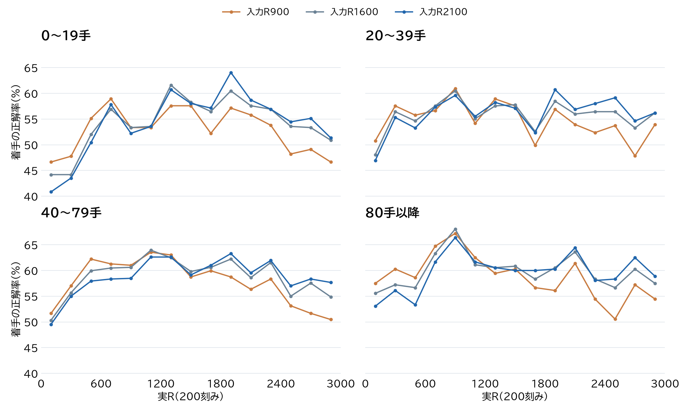
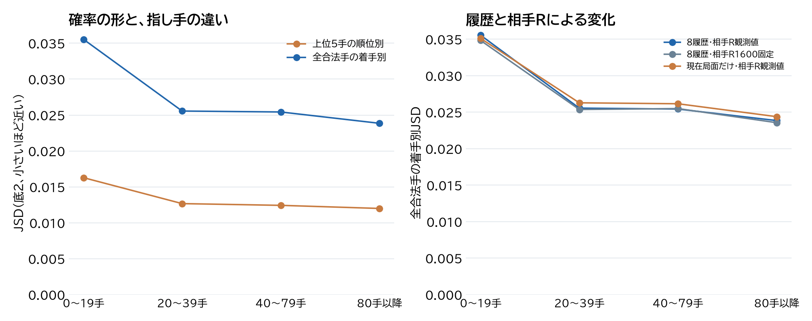

# 論文（GPW2026）に対応した詳細分析

[README に戻る](../README.md)

`v0.1.0-preview` を、R 帯（0〜2999 の 200 刻み）と手数帯を揃えた validation 30,000 局面（各帯 2,000 局面）で分析しました（temperature 1・全合法手正規化、test 集合は未使用）。

足立知己・竹内聖悟「Maia2におけるレート帯別モデルの一貫性と棋力差に関する分析」（GPW2026）の 4.2〜4.5 節に対応する指標を測定しています。原論文とはモデル・学習データ・R 帯の定義が異なるため、数値の厳密な追試ではありません。

---

## 1. 手数別の入力 R 応答



自 R の入力を低・中・高（900 / 1600 / 2100）に変え、相手 R・時計・履歴（最大 8 局面）を観測値に固定しました。

- **実 R 2000〜2999 における入力 R 2100 vs 900 の正解率改善**:
  - 0〜19 手: **+4.60 pt** / 20〜39 手: **+4.60 pt** / 40〜79 手: **+4.91 pt** / 80 手以降: **+4.83 pt**
  - 低 R 帯では低い入力 R、高 R 帯では高い入力 R がよく当たる傾向が、手数が進んでも維持されています。

観測 R を入力したときの手数別成績は以下の通りです（本評価集合では手数とともに一致率が一様に低下する傾向は見られませんでした）。

| 初期局面からの着手数 | 局面数 | 正解率 | policy NLL |
|---|---:|---:|---:|
| 0〜19 手 | 6,720 | 56.18% | 1.2912 |
| 20〜39 手 | 6,645 | 57.13% | 1.3008 |
| 40〜79 手 | 11,235 | 60.54% | 1.2112 |
| 80 手以降 | 5,400 | 61.35% | 1.2123 |

---

## 2. 一致パターンと第一候補の変化


低（900）・中（1600）・高（2100）の順に、各入力 R で人間の手と一致すれば `1`、外せば `0` として分類しました。

| 一致パターン（900 / 1600 / 2100） | 局面の割合 |
|---|---:|
| `111`（全条件で正解） | 52.03% |
| `000`（全条件で不正解） | 38.38% |
| 一部条件のみ正解（`001`〜`110` 合計） | **9.58%** |

- `R900` と `R2100` で第一候補が変わる局面は **15.57%**、3 条件がすべて同じ第一候補を選ぶ割合は **84.29%** でした。
- `000` は「3 条件とも人間の手と一致しなかった」だけで、3 条件が同じ手を選んだことを意味しません。

---

## 3. 順位別 JSD と着手別 JSD



論文に合わせて底 2 の JSD で測定しました。

| R900 と R2100 の比較 | 平均 JSD（底 2） |
|---|---:|
| 順位別 Top-5 確率（大きい順に並べて再正規化） | 0.01327 |
| 着手別（全合法手の同じ着手を対応付け） | 0.02744 |

| 手数区分 | 順位別 JSD ≧ 0.01 | R900 と R2100 で第一候補が変化 |
|---|---:|---:|
| 0〜19 手 | 50.36% | 17.99% |
| 20〜39 手 | 43.61% | 15.71% |
| 40〜79 手 | 42.60% | 14.59% |
| 80 手以降 | 40.61% | 14.44% |

- 順位別 JSD が `0.001` 以下の 2,659 局面でも、その **5.30%** で R900 と R2100 の第一候補が異なりました。順位別の確率形状が似ているだけでは、指し手が同じとは言えません。

---

## 4. 予測確率の校正（ECE）


自他 R と時計を観測値にした 8 履歴の推論では、全体の正解率 **58.95%**、Top-5 **92.52%**、NLL **1.2492**、ECE **0.53 pt**（第一候補の予測確率を 0.1 刻みに区切った加重平均絶対誤差）でした。

全体の信頼度はよく一致していますが、R 帯と手数で細分化した層別 ECE には標本誤差によるばらつきが残ります。また、ECE の小ささは R 条件の再現性や対局棋力を直接示すものではありません。

---

## 5. 履歴と相手 R の対照実験


自 R を観測値に保ったまま、相手 R または過去履歴だけを変更しました（95% 区間は対局単位 bootstrap 2,000 回）。

| 条件 | NLL | 基準からの NLL 差 | 差の 95% 区間 |
|---|---:|---:|---:|
| 全入力を観測値（基準） | 1.2492 | 0 | — |
| 相手 R だけ 1600 固定 | 1.2489 | -0.0003 | -0.0023〜+0.0017 |
| 現在局面だけ（履歴なし） | 1.2986 | +0.0494 | +0.0458〜+0.0533 |

- **履歴省略**: NLL 差は +0.0494 でしたが、自 R 900 vs 2100 による第一候補変更率は現在局面だけでも **16.32%** でした。履歴利用と R 応答を分けて評価する必要があります。
- **相手 R**: 観測自 R を保つ対照では、1600 固定による NLL 差は -0.0003（95% 区間: -0.0023〜+0.0017）でした。区間は0を含み、この条件では明確な優劣を確認できません。 自 R まで 1600 固定した対照での、相手 R 固定による NLL 差は -0.0394 でした。

---

## 集計データと再生成

- 集計 JSON: [paper-diagnostics JSON](metrics/v0.1.0-preview-paper-diagnostics.json)
- 再集計・再描画コマンド（手元のデータセット NPZ を使用、図の再生成には日本語フォントが必要）：

```console
uv run python tools/evaluate_paper_diagnostics.py --model models/v0.1.0-preview --dataset /path/to/matched-paper-validation.npz --cache work_dir/paper-cache.npz --output docs/metrics/v0.1.0-preview-paper-diagnostics.json
uv run python tools/plot_paper_diagnostics.py docs/metrics/v0.1.0-preview-paper-diagnostics.json
```
