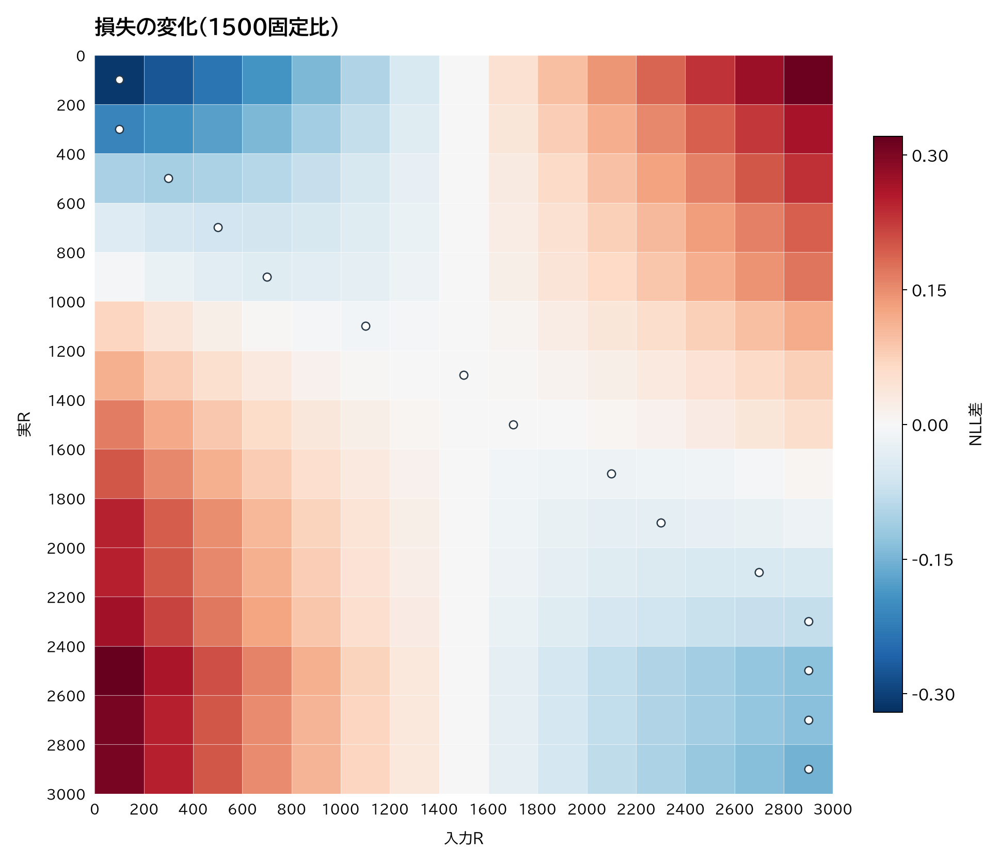

# 実Rと入力Rの対応

全15帯で各2,000局面。20手刻みの手数帯の内訳も揃えています。
両軸は200刻みで、入力値は各帯の中央（100、300、…、2900）です。
丸は各実R帯で標本上の最良値だった入力帯を示します。

[拡大用SVG](assets/rating-input-accuracy.svg)

## 1500固定からの改善

青は改善、赤は悪化です。同じ局面で自分の入力Rだけを変えています。

## 損失で見る

青は実際の着手に与えた確率の改善です。

## 高レート帯での再確認

実R2800〜2999の2,000局面（72対局）で、入力R2900との差を示します。
陰影は対局単位bootstrapの95%区間です。

正解率は入力R2900で58.50%、NLLは入力R2900で最良でした。
以前の127局面で見えた「入力R1700と1900が正解率で最高」という結果は、今回の標本では再現しませんでした。

605,000更新EMA、validation計30,000局面。未使用testは使っていません。
丸は細かなRの優劣や、指定Rでの対局棋力を確定するものではありません。

[数値表と測定条件](rating-response-details.md) / [集計JSON](metrics/preview-step-0605000-rating-matrix.json)
