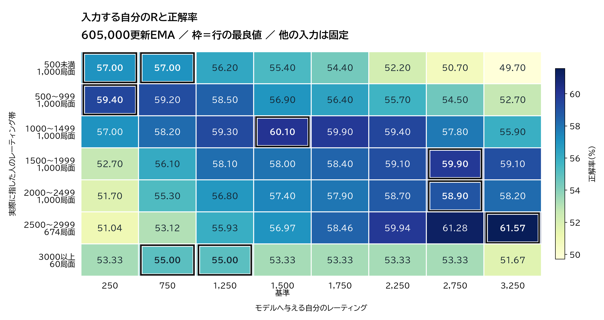
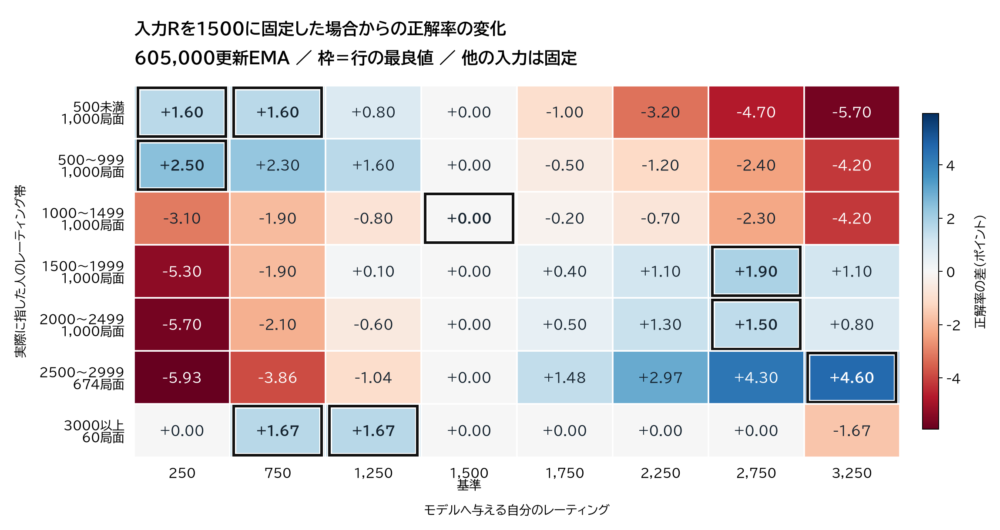

# 入力レーティングと予測の関係

自分の入力Rを変えると、正解率が高くなる実際の棋力帯も変わります。
低R帯には低い入力R、高R帯には高い入力Rが有利になる傾向があります。
ただし、試した候補で正解率が最も高くなる入力Rは、実際のRと必ずしも一致しません。

## 正解率

行は実際に指した人のR帯、列はモデルに与える自分のRです。
枠は各行で正解率が最も高いセルを示し、同率なら全て囲みます。



## 1500固定からの変化

同じ行の1500列を基準にした正解率の差です。
青は改善、赤は悪化を表します。
棋力帯ごとの元々の難しさを分けて、入力Rを変える効果を比較できます。



## 各棋力帯で最も良かった入力R

以下は試した8候補の中での標本上の最良値です。
最適な入力Rを確定した結果や、対局棋力の校正値ではありません。

| 実際のR帯 | 局面数 | 正解率が最高の入力R | NLLが最小の入力R |
|---|---:|---:|---:|
| 500未満 | 1,000 | 250 / 750 | 250 |
| 500〜999 | 1,000 | 250 | 750 |
| 1000〜1499 | 1,000 | 1500 | 1500 |
| 1500〜1999 | 1,000 | 2750 | 2250 |
| 2000〜2499 | 1,000 | 2750 | 2750 |
| 2500〜2999 | 674 | 3250 | 3250 |
| 3000以上 | 60 | 750 / 1250 | 3250 |

正解率は第一候補だけを評価し、NLLは実際の着手に与えた確率を評価します。
両者の最良の入力Rが違う場合があります。
3000以上は60局面しかなく、正解率が1局面で約1.67ポイント変わるため、参考値です。
上限の3250で最良になった帯でも、より高い入力Rを試した結果ではありません。


## 入力Rごとに正解率が最高だった実R帯

こちらはヒートマップを列方向に比較した結果です。
棋力帯ごとの予測しやすさも混ざるため、条件付けの妥当性は上の改善幅と併せて見てください。

| 入力R | 正解率が最高の実R帯 | 正解率 |
|---:|---|---:|
| 250 | 500〜999 | 59.40% |
| 750 | 500〜999 | 59.20% |
| 1250 | 1000〜1499 | 59.30% |
| 1500 | 1000〜1499 | 60.10% |
| 1750 | 1000〜1499 | 59.90% |
| 2250 | 2500〜2999 | 59.94% |
| 2750 | 2500〜2999 | 61.28% |
| 3250 | 2500〜2999 | 61.57% |

## 測定条件

605,000更新EMA、CPU float32、全合法手で正規化、温度1です。
既存の検証用50,000局面のうちRが既知の局面から、各R帯を上限1,000局面として一様に無作為抽出しました。
seedは20261120、合計5,734局面で、未使用testは使っていません。
各行の全入力Rで同じ局面を使い、相手R、時計、最大8局面の履歴は観測値のまま固定しています。
棋力帯を均等に近づけたこの標本の全体平均と、自然頻度50,000局面の全体成績は直接比較しません。
この図から細かなRの最適値や、近い候補間の統計的な優劣を確定することはできません。

[集計JSON](metrics/preview-step-0605000-rating-matrix.json)に候補、各セルの数値、標本数、重みとデータのSHA-256を保存しています。
局面ごとの情報は含めません。

## 再生成

```console
uv sync --group analysis
uv run python tools/evaluate_rating_matrix.py --model models/preview-step-0605000 --dataset /path/to/private-validation.npz --output docs/metrics/preview-step-0605000-rating-matrix.json
uv run python tools/plot_metrics.py docs/metrics/preview-step-0605000.json --rating-matrix docs/metrics/preview-step-0605000-rating-matrix.json
```

日本語フォントが必要です。
Noto Sans CJK JP、BIZ UDPゴシック、メイリオなどを自動で選択します。
